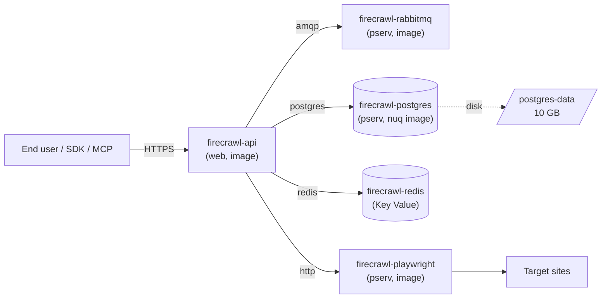

# Firecrawl on Render

> Self-host the open-source Firecrawl web-scraping API on Render in one click — API, Playwright worker, Postgres queue, RabbitMQ, and Redis, wired together over the private network.

[](https://render.com/deploy-template/api/github/start?template_repo=firecrawl)

Firecrawl ([github.com/firecrawl/firecrawl](https://github.com/firecrawl/firecrawl)) is the scrape/crawl/search API that powers Mendable's hosted product. This template deploys the AGPL-3.0 self-host edition on Render with the full backend stack pre-wired: NUQ Postgres queue (`pg_cron`-backed), RabbitMQ for `pg_notify` fan-out, Render Key Value for rate limiting, and a separate Chromium-backed Playwright worker. You get the same API surface as `api.firecrawl.dev`, running on infrastructure you own.

---

## Table of contents

- [Why deploy Firecrawl on Render](#why-deploy-firecrawl-on-render)
- [Use cases](#use-cases)
- [What gets deployed](#what-gets-deployed)
- [Quickstart](#quickstart)
- [Configuration](#configuration)
- [Cost breakdown](#cost-breakdown)
- [Customization](#customization)
- [Operations](#operations)
- [Upgrading](#upgrading)
- [Troubleshooting](#troubleshooting)
- [FAQ](#faq)
- [Security](#security)
- [Caveats and limitations](#caveats-and-limitations)
- [Credits and license](#credits-and-license)

---

## Why deploy Firecrawl on Render

- **Whole stack wired for you** — API, Playwright worker, Postgres, RabbitMQ, and Redis are connected over the private network with no copy-pasted connection strings.
- **Random Postgres password generated on first deploy** — `BULL_AUTH_KEY` and `POSTGRES_PASSWORD` are `generateValue: true`, so the admin UI and the queue are never left with the upstream `CHANGEME` default.
- **Stateful pieces live on disks, not ephemeral filesystems** — Postgres data and RabbitMQ data survive redeploys and instance restarts.
- **Auto-deploys upstream images** — pinned to `ghcr.io/firecrawl/*:latest` so Render redeploys when upstream publishes a new digest. Pin to an explicit version when you want predictability ([see below](#pin-the-upstream-version)).

## Use cases

What you can build or run with this template:

- **Self-hosted scrape API for compliance-heavy products** — keep target URLs and scraped content inside your own VPC-equivalent.
- **Backend for an LLM RAG pipeline** — crawl a docs site once, expose the markdown to your agents via Firecrawl's `/v2/crawl` and `/v2/scrape`.
- **Drop-in replacement for `api.firecrawl.dev` during development** — point `FIRECRAWL_API_URL` at your `*.onrender.com` host so SDK code paths exercise your fork.
- **Behind-the-firewall scraping** — combine with an outbound proxy via `PROXY_SERVER` to give the agent crawler a stable egress IP.
- **MCP/agent tool host** — pair with [`firecrawl-mcp`](https://github.com/firecrawl/firecrawl-mcp-server) for Claude, Cursor, or any MCP client.

## What gets deployed



| Resource | Type | Plan | Purpose |
|----------|------|------|---------|
| `firecrawl-api` | Web service (Docker) | `pro` (4 GB) | API + in-process queue/scrape/extract/nuq workers. Thin Dockerfile wraps `ghcr.io/firecrawl/firecrawl:latest` so `entrypoint.sh` can build `NUQ_RABBITMQ_URL` and `PLAYWRIGHT_MICROSERVICE_URL` from `fromService.hostport` values. Public on `*.onrender.com`. |
| `firecrawl-playwright` | Private service (image) | `standard` (2 GB) | Chromium-backed scraper. Render assigns a suffixed slug (e.g. `firecrawl-playwright-vt4c:3000`); the Blueprint wires it via `fromService.hostport`. |
| `firecrawl-postgres` | Private service (image) | `standard` (2 GB) | Custom `nuq-postgres` image with `pg_cron` + the NUQ queue schema. Render assigns a suffixed slug (e.g. `firecrawl-postgres-ib8d:5432`); the Blueprint wires `POSTGRES_HOST` via `fromService.host`. |
| `firecrawl-rabbitmq` | Private service (image) | `starter` (512 MB) | RabbitMQ 3 broker for `pg_notify` fan-out. **Intentionally ephemeral** — the authoritative queue state is in Postgres, so rabbit doesn't need a disk. |
| `firecrawl-redis` | Key Value | `starter` | Cache + rate-limit store. Wired via `fromService.connectionString`. |
| `postgres-data` | Disk on `firecrawl-postgres` | 10 GB SSD | Persists `/var/lib/postgresql/data`. |

Region: **Oregon (`oregon`)** — edit `render.yaml` if you need Frankfurt, Singapore, Ohio, or another region. All five resources must share a region for the private network to route between them.

## Quickstart

1. Click **[Deploy to Render](https://render.com/deploy-template/api/github/start?template_repo=firecrawl)**.
2. Authorize the Render GitHub App and pick a GitHub account to fork this template into. Render creates `<your-account>/firecrawl` for you.
3. Render reads `render.yaml` and shows the apply screen. Leave the auto-generated secrets alone; paste an `OPENAI_API_KEY` if you want JSON extraction (optional), and skip the proxy/SearXNG fields unless you need them.
4. Click **Apply**. The first deploy takes **~5–8 minutes** — Postgres has to run `initdb` against the NUQ schema, Render has to pull four images, and the API harness waits for Postgres + RabbitMQ liveness before binding the port.
5. When `firecrawl-api` is `live`, hit `https://<your-service>.onrender.com/v0/health/liveness` — expect `{"status":"ok"}`. Then try a real scrape:

   ```bash
   curl -X POST 'https://<your-service>.onrender.com/v2/scrape' \
     -H 'Content-Type: application/json' \
     -d '{"url": "https://firecrawl.dev"}'
   ```

   The self-hosted API does not require an `Authorization` header (see [SELF_HOST.md](https://github.com/firecrawl/firecrawl/blob/main/SELF_HOST.md#api-keys-for-sdk-usage)).

## Configuration

### Required secrets

You set these in the Render dashboard during the Apply step. None are strictly required for a working deploy — the template runs unauthenticated by default — but several unlock optional features.

| Env var | What it's for | How to get it |
|---------|---------------|---------------|
| `OPENAI_API_KEY` | Enables AI features: JSON extraction on `/v2/scrape`, the `/v2/extract` endpoint, and structured `/v2/agent` output. Leave blank to disable. | [platform.openai.com/api-keys](https://platform.openai.com/api-keys) |
| `PROXY_SERVER` | Outbound HTTP proxy URL (e.g. `http://1.2.3.4:8080`). Leave blank if you don't route scrapes through a proxy. | Your proxy provider |
| `PROXY_USERNAME` | Proxy basic-auth user. Leave blank for an unauthenticated proxy. | Your proxy provider |
| `PROXY_PASSWORD` | Proxy basic-auth password. Leave blank for an unauthenticated proxy. | Your proxy provider |
| `SEARXNG_ENDPOINT` | Self-hosted SearXNG URL to replace Google for `/v2/search`. Leave blank to use Google. | Your SearXNG host |

### Auto-generated secrets

Render generates these on first deploy and stores them as service env vars. **Do not rotate them later** — rotating `POSTGRES_PASSWORD` requires resetting the database, and rotating `BULL_AUTH_KEY` invalidates the admin UI URL.

| Env var | Purpose |
|---------|---------|
| `POSTGRES_PASSWORD` | Postgres superuser password. Owned by `firecrawl-postgres`; the api reads it via `fromService.envVarKey`. |
| `BULL_AUTH_KEY` | Protects the queue admin UI at `https://<your-service>.onrender.com/admin/<BULL_AUTH_KEY>/queues`. |

### Wired automatically from other resources

The Blueprint wires these via `fromDatabase`, `fromService`, and literal values pointing at private DNS names. You never type them.

| Env var | Source |
|---------|--------|
| `REDIS_URL` | `firecrawl-redis.connectionString` |
| `REDIS_RATE_LIMIT_URL` | `firecrawl-redis.connectionString` |
| `POSTGRES_HOST` | Literal `firecrawl-postgres` (private DNS) |
| `POSTGRES_PORT` | Literal `5432` |
| `POSTGRES_DB` | `firecrawl-postgres.POSTGRES_DB` |
| `POSTGRES_USER` | `firecrawl-postgres.POSTGRES_USER` |
| `POSTGRES_PASSWORD` | `firecrawl-postgres.POSTGRES_PASSWORD` |
| `NUQ_RABBITMQ_URL` | Literal `amqp://firecrawl-rabbitmq:5672` |
| `PLAYWRIGHT_MICROSERVICE_URL` | Literal `http://firecrawl-playwright:3000/scrape` |

### Optional tweaks

Common things people change after deploying. Override in the dashboard or edit `render.yaml`.

| Env var | Default | What it does |
|---------|---------|--------------|
| `NUQ_WORKER_COUNT` | `2` | Number of NUQ scrape worker child processes inside the api container. Upstream default is `5`; reduced here to fit the 4 GB plan. |
| `NUM_WORKERS_PER_QUEUE` | `4` | Per-queue concurrency. Upstream default is `8`. |
| `CRAWL_CONCURRENT_REQUESTS` | `5` | Concurrent in-flight scrapes per crawl job. Upstream default is `10`. |
| `MAX_CONCURRENT_JOBS` | `3` | Cap on simultaneous crawl jobs. Upstream default is `5`. |
| `BROWSER_POOL_SIZE` | `3` | Chromium contexts held warm in the Playwright service. Upstream default is `5`. |
| `MAX_CPU` | `0.8` | Worker rejects new jobs above this CPU utilization. |
| `MAX_RAM` | `0.8` | Worker rejects new jobs above this memory utilization. |
| `LOGGING_LEVEL` | `info` | One of `debug`, `info`, `warn`, `error`. |
| `MAX_CONCURRENT_PAGES` | `5` | (Playwright service) max concurrent browser tabs. |
| `BLOCK_MEDIA` | `true` | (Playwright service) blocks images/video/fonts to cut bandwidth and RAM. |

Full upstream config reference: [SELF_HOST.md](https://github.com/firecrawl/firecrawl/blob/main/SELF_HOST.md).

## Cost breakdown

Reference prices from [render.com/pricing](https://render.com/pricing) at time of writing. Confirm current pricing on the dashboard before launching.

| Resource | Plan | Approx. monthly cost |
|----------|------|----------------------|
| `firecrawl-api` (web, image) | `pro` (4 GB / 2 CPU) | $85 |
| `firecrawl-playwright` (pserv) | `standard` (2 GB / 1 CPU) | $25 |
| `firecrawl-postgres` (pserv) | `standard` (2 GB / 1 CPU) | $25 |
| `firecrawl-rabbitmq` (pserv) | `starter` (512 MB / 0.5 CPU) | $7 |
| `firecrawl-redis` (Key Value) | `starter` (256 MB) | $10 |
| `postgres-data` (disk) | 10 GB SSD | $2.50 |
| **Total** | | **~$155/month** |

**Cheaper:** drop `firecrawl-api` to `standard` (2 GB) and set `NUQ_WORKER_COUNT=1` — the API will still respond but throughput drops. Drop `firecrawl-playwright` to `starter` only if you also drop `MAX_CONCURRENT_PAGES=1`; Chromium needs the RAM.

**Scale up:** bump `firecrawl-api` to `pro_plus` (8 GB) and restore `NUQ_WORKER_COUNT=5` / `NUM_WORKERS_PER_QUEUE=8` to match upstream defaults. Add a second instance via `scaling.numInstances` on `firecrawl-api` (stateless) — but **leave `firecrawl-postgres` and `firecrawl-rabbitmq` at one instance** because both own disks.

## Customization

### Pin the upstream version

The template tracks `:latest` for all three Firecrawl images. To pin:

```yaml
# render.yaml
services:
  - type: web
    name: firecrawl-api
    image:
      url: ghcr.io/firecrawl/firecrawl@sha256:<digest>    # immutable
      # or
      url: ghcr.io/firecrawl/firecrawl:v2.10             # semver tag
```

Repeat for `firecrawl-playwright` and `firecrawl-postgres`. Always pin all three together — the NUQ schema and the harness version must match.

### Add a custom domain

In the Render dashboard, open `firecrawl-api` → **Settings** → **Custom Domains** → **Add**. Render issues a TLS certificate automatically once the CNAME resolves. Full DNS instructions: [Render custom domains docs](https://render.com/docs/custom-domains).

### Swap in a managed Postgres

You can't — see the [Caveats](#caveats-and-limitations) section. Firecrawl's NUQ queue requires `pg_cron` extension and runs DDL/cron jobs in `initdb`. Render's managed Postgres doesn't support either. The custom `nuq-postgres` image is the only supported configuration today.

### Enable authentication

Self-hosted Firecrawl runs **unauthenticated by default** (see upstream [SELF_HOST.md → API Keys for SDK Usage](https://github.com/firecrawl/firecrawl/blob/main/SELF_HOST.md#api-keys-for-sdk-usage)). To restrict access, put `firecrawl-api` behind:

- A Render IP allowlist on the service (Pro plan and up), or
- Cloudflare Access / Tailscale Funnel in front of the `*.onrender.com` URL, or
- The `firecrawl-api` service's [private-network-only setting](https://render.com/docs/private-services) by changing `type: web` to `type: pserv` (it then becomes reachable only from other Render services).

### Scale the API horizontally

```yaml
# render.yaml
- type: web
  name: firecrawl-api
  scaling:
    minInstances: 1
    maxInstances: 3
    targetCPUPercent: 70
```

The api container is stateless — all state lives in Postgres, RabbitMQ, and Redis — so horizontal scaling is safe. The harness inside each instance still spawns its own worker children; that's expected.

## Operations

### Backups

- **Postgres:** the `postgres-data` disk has [automatic daily snapshots](https://render.com/docs/disks#snapshots) retained for 7 days on paid plans. Restore via dashboard. The NUQ queue is mostly ephemeral — completed jobs are deleted by `pg_cron` after 1 hour, failed jobs after 6 hours — so the disk holds mostly in-flight queue rows and isn't a long-term archive.
- **RabbitMQ:** disk snapshots also apply. RabbitMQ's persisted queues survive restarts.
- **Application state:** scraped content is **returned in the API response, not persisted**. If you need archival, store responses in your own object storage on the client side.

### Monitoring

Each service exposes CPU, memory, request rate, and response time charts under **Metrics** in the dashboard. `firecrawl-api` has `healthCheckPath: /v0/health/liveness`, so Render will mark deploys unhealthy and roll back if the API can't bind a port within the health-check window.

### Scaling

`firecrawl-api` is stateless — set `scaling.minInstances` / `scaling.maxInstances` to add capacity. The other four services (Postgres, RabbitMQ, Playwright, Redis) are single-instance:

- Postgres and RabbitMQ own disks; multi-instance with the same disk isn't supported.
- The Playwright service is technically stateless but heavy on RAM — scale vertically (bigger plan) before scaling horizontally.
- Render Key Value is single-instance by design.

### Logs

In the Render dashboard, open the service → **Logs**. Or via CLI:

```bash
render logs --resources <service-id> --tail
```

The API harness logs are colorized per worker (api, worker, extract-worker, nuq-worker-N, nuq-prefetch-worker, nuq-reconciler).

## Upgrading

### Pick up upstream releases

Because the template pins `:latest`, Render redeploys automatically when upstream publishes a new image **only if** you have `autoDeployTrigger` set to detect image digest changes. By default, you must trigger a manual deploy:

1. Dashboard → `firecrawl-api` → **Manual Deploy** → **Clear build cache & deploy**.
2. Repeat for `firecrawl-playwright` and `firecrawl-postgres`.

Upgrade all three images in the same window — the NUQ queue schema and the api harness expect compatible versions.

For automated upgrades, switch to explicit version tags and bump via PR. The [Renovate Docker manager](https://docs.renovatebot.com/modules/manager/docker/) understands `image.url` references in `render.yaml`.

### Breaking-change migrations

Watch the upstream [Firecrawl releases](https://github.com/firecrawl/firecrawl/releases) before upgrading across major versions. Notable migrations to date:

- **v2.0 (Sep 2024)** — endpoint path moved from `/v1/scrape` to `/v2/scrape`. Update your SDK to `firecrawl-py>=2.0` / `@mendable/firecrawl-js>=2.0`.
- **NUQ queue migration** — pre-NUQ Firecrawl (≤ v1.x) used a Bull queue on Redis only. This template ships the post-NUQ stack (Postgres + RabbitMQ + Redis). You can't downgrade to a pre-NUQ image without removing the `firecrawl-postgres` and `firecrawl-rabbitmq` services.

## Troubleshooting

### Deploy fails during image pull

`ghcr.io/firecrawl/*` images are public, so this is rare. If it does happen:

- Check `https://github.com/firecrawl/firecrawl/pkgs/container/firecrawl` — confirm the tag exists.
- Hit "Clear build cache & deploy" in the dashboard. Render caches image digests aggressively.
- If pinning to a digest with `@sha256:`, double-check the digest is for the right architecture (Render runs `linux/amd64`).

### `firecrawl-api` health check fails with "No open ports detected"

The api harness waits for Postgres and RabbitMQ before binding port 3002. If either backend is slow to start, the api hits Render's health-check timeout. Fixes:

- Check `firecrawl-postgres` logs for `database system is ready to accept connections` and `firecrawl-rabbitmq` for `Server startup complete`. Both should appear in the first 60–90 seconds.
- If Postgres logs show `data directory "/var/lib/postgresql/data" has wrong ownership`, the disk was created out of order. Delete the disk and redeploy.
- If you downgraded `firecrawl-api` below `standard`, you'll see Node OOM crashes (`Reached heap limit Allocation failed - JavaScript heap out of memory`). Restore `pro` or higher.

### `ERROR - Attempted to access Supabase client when it's not configured`

This is harmless. Firecrawl uses Supabase for advanced logging on the cloud product; self-hosted instances don't configure it. The error appears in logs but does not affect scraping. See upstream [SELF_HOST.md → Supabase client is not configured](https://github.com/firecrawl/firecrawl/blob/main/SELF_HOST.md#supabase-client-is-not-configured).

### `WARN - You're bypassing authentication`

Self-hosted Firecrawl runs unauthenticated by default. This warning is expected. If you need auth, see [Enable authentication](#enable-authentication) above.

### Postgres logs show `pg_cron: failed to start background worker`

`pg_cron` requires `shared_preload_libraries = 'pg_cron'` and `cron.database_name = 'postgres'`. The `nuq-postgres` image sets both, but if you overrode `POSTGRES_DB` away from `postgres` in `render.yaml`, the cron extension cannot find its target database. Restore `POSTGRES_DB: postgres` or rebuild the image with a matching `cron.database_name`.

### Anything else

- Service-level logs: dashboard → **Logs** (or `render logs --resources <id> --tail`)
- Deploy-level logs: dashboard → **Events** → click the failed deploy
- Open an issue in this template repo for Render-specific bugs
- Open an issue [upstream](https://github.com/firecrawl/firecrawl/issues) for Firecrawl application bugs

## FAQ

### Can I run this on Render's free plan?

No. Free web services sleep after 15 minutes of inactivity, which breaks the in-process queue workers, and 512 MB is far below Firecrawl's startup memory floor. The minimum supported plan is `standard` (2 GB) for `firecrawl-api`, and `pro` (4 GB) is what the template ships.

### How do I migrate from an existing self-hosted Firecrawl?

The NUQ Postgres schema is queue state only — there's no long-lived application data to migrate. Steps:

1. Drain the source instance (stop accepting new requests, wait for in-flight crawls).
2. Deploy this template.
3. Cut over your client code by changing the API base URL.

If you want to preserve in-flight crawl IDs across the cutover, dump/restore the `nuq.*` tables from the source Postgres to the destination via `render psql --resources firecrawl-postgres` + `pg_dump` / `pg_restore`. Most users skip this.

### Can I use my own Postgres or my own RabbitMQ?

Yes. Remove the `firecrawl-postgres` and/or `firecrawl-rabbitmq` services from `render.yaml`, and replace the `fromService` references on `firecrawl-api` with literal `value:` strings pointing at your hosts. Constraints:

- Your Postgres **must** have the [`pg_cron`](https://github.com/citusdata/pg_cron) extension and you must run the [`nuq.sql`](https://github.com/firecrawl/firecrawl/blob/main/apps/nuq-postgres/nuq.sql) schema by hand once.
- Your RabbitMQ **must** speak AMQP 0-9-1 — anything from `rabbitmq:3.x` upward works.

### What happens if I delete the `postgres-data` disk?

`firecrawl-postgres` re-runs `initdb` on the next boot, which re-creates the NUQ schema. You lose in-flight queue jobs but the api will keep working. Treat this as a nuclear reset for the queue.

### Why not use Render's managed Postgres?

Firecrawl's NUQ queue requires the `pg_cron` extension and runs DDL during `initdb` (`apps/nuq-postgres/nuq.sql`). Render's managed Postgres does not currently support `pg_cron`, and `initdb` scripts only run on a self-managed image. The custom `nuq-postgres` image is the only supported configuration today. Managed Postgres trades the customizability for daily backups, HA, and read replicas — when Firecrawl ships a `pg_cron`-free queue backend, this template will switch.

### Can I scale this beyond one region?

Render's private network is region-scoped — all five resources must share a region. For multi-region, deploy this stack independently in each region and put a global LB (Cloudflare, Fly Anycast, etc.) in front of the `*.onrender.com` URLs.

## Security

- **Encryption at rest:** Render disks (`postgres-data`, `rabbitmq-data`) are encrypted by Render's storage layer. Render Key Value is encrypted at rest.
- **Encryption in transit:** TLS terminates at the `*.onrender.com` hostname for `firecrawl-api`. The four private services (`firecrawl-playwright`, `firecrawl-postgres`, `firecrawl-rabbitmq`, `firecrawl-redis`) communicate over Render's private network without TLS — fine for service-to-service traffic inside the same workspace.
- **Network exposure:** `firecrawl-api` is the only public endpoint. The other four services are unreachable from the public internet.
- **Secret rotation:**
  - **Safe to rotate:** `OPENAI_API_KEY`, `PROXY_*`. Update in dashboard; no redeploy required for the env to apply on next worker spawn.
  - **Dangerous to rotate:** `BULL_AUTH_KEY` (invalidates the admin UI URL — note the new one), `POSTGRES_PASSWORD` (requires recreating the Postgres role).
- **Reporting vulnerabilities:** template-specific bugs → this repo's issues. Firecrawl application bugs → [upstream security policy](https://github.com/firecrawl/firecrawl/security).

## Caveats and limitations

- **No managed Postgres.** Render's managed Postgres lacks `pg_cron`, so the template runs `nuq-postgres` as a private service. You lose Render's daily logical backups, point-in-time recovery, and the managed HA tier. Disk snapshots (7-day retention) are the closest substitute.
- **No managed RabbitMQ.** Render doesn't offer managed AMQP. RabbitMQ runs as a single-instance pserv with a 1 GB disk. Lose the disk → lose any in-flight queue messages.
- **Single-instance Postgres and RabbitMQ.** Both services own disks; you can't run multiple instances. Vertical scaling only.
- **Five resources × Oregon.** The Blueprint deploys five resources in one region. Inter-region private networking is not available on Render today.
- **`:latest` image tags by default.** Upstream can push a breaking change at any time. Pin to immutable digests for production ([Pin the upstream version](#pin-the-upstream-version)).
- **Standard plan is the floor for `firecrawl-api`.** Downgrading to `starter` causes Node OOM during harness startup; the log signature is `Reached heap limit Allocation failed - JavaScript heap out of memory` followed by Render's port-scanner emitting `==> No open ports detected`.
- **First image pull takes ~90 seconds per service.** Subsequent deploys are <30s because Render caches the digest.
- **No authentication out of the box.** Self-hosted Firecrawl matches upstream's no-auth default. Anyone with the `*.onrender.com` URL can hit the API. Lock it down before exposing it broadly — see [Enable authentication](#enable-authentication).
- **AGPL-3.0.** The upstream Firecrawl API is AGPL-3.0. If you offer this as a hosted service to third parties, you must publish your modifications under AGPL-3.0. The SDKs and this template are MIT.

## Credits and license

- **Upstream:** [firecrawl/firecrawl](https://github.com/firecrawl/firecrawl) — AGPL-3.0
- **Render template:** MIT (see [LICENSE](./LICENSE))
- **Template maintainer:** [render-examples](https://github.com/render-examples)

If this template helped you, give [upstream](https://github.com/firecrawl/firecrawl) a star.
